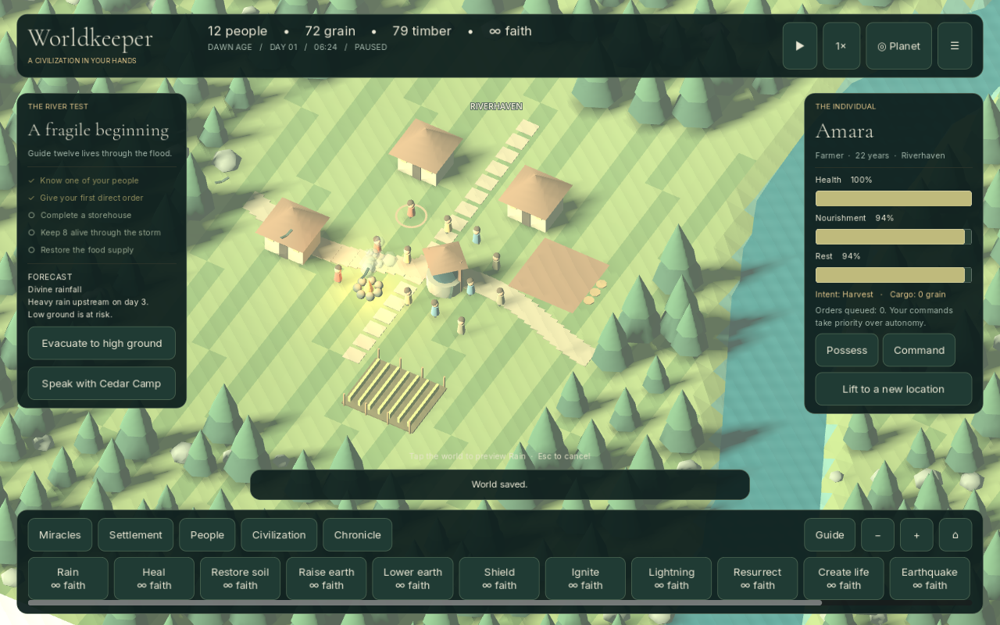

# Worldkeeper

An original, offline 3D god-game for **Android**, built with **Godot 4.6.3 stable** (`7d41c59c4`). Guide twelve named settlers through a river flood, take direct control of their actions, and grow a civilization toward an observatory. The supplied [Worldkeeper brief](docs/Worldkeeper-original.md) is preserved in full.



## Play on Android

1. Open this repository's **Actions → Test and build Worldkeeper** and select a successful run.
2. Download **Worldkeeper-Android-arm64**, extract the ZIP, and open `Worldkeeper-android.apk` on your phone. Allow installation from that download source when Android asks.
3. Play in **landscape**. This build targets ARM64 Android 7.0+ with OpenGL ES 3.0 support. It is a debug-signed preview, not a Play Store release. Updates built with a different debug certificate may require uninstalling the previous preview first (which deletes local saves).

An APK was also exported and signature-verified during development; see [QA](docs/QA.md). Physical phone installation, thermals, and sustained frame rate still require device testing. There is no login, backend, advertising, or network requirement.

## Your five objectives

- Inspect one person and understand their needs.
- Give a direct order.
- Complete a storehouse.
- Keep at least eight settlers alive through the day-three flood.
- Restore a working food supply after the storm.

Continue after the River Test: establish trade, build a market and workshop, research industry, install wind power, unlock the planetary age, and construct an observatory. The longer stewardship goal requires food-route access between Riverhaven and the western refuge for an uninterrupted year.

## Controls

**Phone:** drag to pan, pinch to zoom; tap people or choose them from **People**. The command sheet provides orders, possession, and divine lifting. Use the movement pad while possessing. **Guide** always opens the objectives, evacuation, help, and camp diplomacy. The lower action row scrolls horizontally. Miracles preview their footprint and affected residents before confirmation. **☰** contains saves, seed entry, graphics, audio, and accessibility settings.

**Desktop:** left-click selects or casts; drag pans; right-drag orbits; wheel zooms; Space pauses; Tab toggles globe overview; Escape cancels. Possession uses WASD and E to gather. A direct order or divine lift explicitly releases possession. Shift from 1× to 4× or 16× with the speed button. One day lasts eight real minutes at 1×.

**God powers:** rain, healing, soil restoration, raise/lower terrain, shielding, ignition, lightning, resurrection, create life, earthquakes, wind, and cooling. Sandbox starts enabled: miracles are free, extinction is recoverable, stocks can be edited, and new citizens can belong to either faction. Challenge uses regenerating faith. All visible citizens can be selected, assigned roles, ordered, lifted, possessed, killed, or resurrected.

## Run from source

Install the exact **Godot 4.6.3 standard editor**, not the .NET edition. No addons or external code dependencies are required.

```sh
godot --headless --path . --editor --import --quit
godot --path .
godot --headless --path . --script tests/run_tests.gd
godot --headless --path . --script tests/progression.gd
godot --headless --path . --quit-after 500 -- --input-smoke
godot --headless --path . -- --smoke
```

The input smoke test must print `INPUT_SMOKE_PASS`; the progression test must print `PROGRESSION_PASS`. A script assertion does not automatically terminate Godot, so CI uses a timeout and checks these markers.

## Export

Install matching **4.6.3 export templates**. Desktop presets are included:

```sh
mkdir -p builds
godot --headless --path . --export-release Linux builds/Worldkeeper-linux.x86_64
godot --headless --path . --export-release Windows builds/Worldkeeper-windows.exe
```

For Android, install JDK 21, Android platform-tools, `build-tools;36.0.0`, and `platforms;android-36`. Set `JAVA_HOME` and `ANDROID_HOME`, then:

```sh
python3 tools/configure_android.py
godot --headless --path . --export-debug Android builds/Worldkeeper-android.apk
```

Godot's editor settings need a debug keystore, alias, and password. Opening the Android export preset in the editor generates the usual local debug keystore. CI explicitly generates one if missing. Signing keys and local SDK paths are never committed. Release signing and Play Store publication are not configured.

## Design and scope

The simulation is independent of the 3D scene. It has stable IDs, separate random streams, validated player commands, a wrapped 128×64 grid, explicit cargo interruption rules, deterministic persistence, and a linked chronicle. Saves use a versioned JSON envelope with a base64 Godot Variant payload to preserve exact floating-point and RNG values. The previous good save rotates to `.bak`; invalid primary saves fall back to that backup. Loading validates the state before changing the active game.

This is a **playable first release foundation**, with original stylized procedural graphics. It is not a feature-complete reproduction of *The Universim* or completion of all eight production milestones in the brief. Floods use a tuned river-level model and levee/bank protection; diplomacy, household logistics, combat, and climate are simplified. The globe shows the same terrain but is an overview, not seamless surface navigation. Family generations, full regional transport inventories, sophisticated floods, technology trees, large faction wars, colonization, remappable controls, and production art remain future work. See [development plan](docs/DEVELOPMENT.md) for the explicit boundaries.

Genre reference: [The Universim on Steam](https://store.steampowered.com/app/352720/The_Universim/). Worldkeeper uses original names, models, UI, writing, rules and sounds. See [asset provenance](docs/CREDITS.md).
